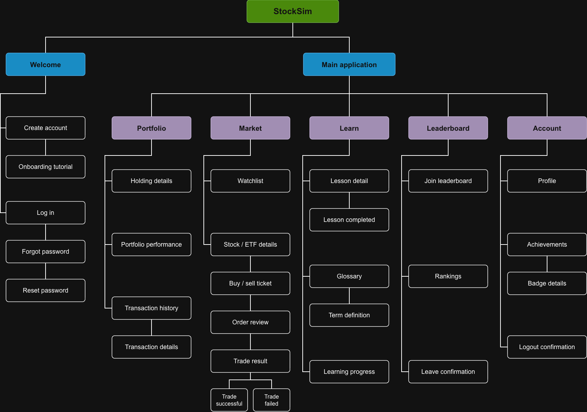

# StockSim UX Design

## Prototype

[Clickable Figma Prototype](https://www.figma.com/proto/g70yswfi7eiE1ObrrkOku6/StockSim-Prototype?node-id=25-2533&p=f&t=nlbRFlCF17PWIStv-0&scaling=min-zoom&content-scaling=fixed&page-id=25%3A2532&starting-point-node-id=25%3A2533&show-proto-sidebar=1)

The prototype turns the app map and wireframes below into a clickable flow.

## App Map

The app splits into two parts: a Welcome flow that new users see before logging in, and the main application after login. The main application has five sections: Portfolio, Market, Learn, Leaderboard, and Account.

## Wireframes
### 1. Welcome, Access & Onboarding

How a new user gets in. Screens run in flow order: Welcome, Create Account (with a validation state), three onboarding slides (Trade, Cash, Learn), Log In (with a login error state), Forgot Password, Reset Email Sent or Reset Email Error, Reset Password (with Password Mismatch and Reset Expired states), and Password Saved.

- Onboarding shows once, right after account creation.
- Validation errors appear inline on the form, not on a new page.
- Password reset links expire, which is what the Reset Expired screen covers.

### 2. Market, Watchlist & Trading

The largest module: finding a stock, viewing it, and buying or selling with virtual cash.

- Browse and search: Market, Search Results and Search Empty, plus Watchlist with its Empty, Remove and Removed states. The watchlist is per user, removing asks for confirmation, and empty states point back to Market.
- Stock details: the period toggle (Day, Week, All) re-slices the chart, tapping the chart shows the value at that point, and saving or removing adds or removes the stock from the watchlist.
- Buy flow: Buy Ticket, then Buy Review. The quote can change between the two, so Quote Changed and Updated Review make the user accept the new price. Trade Pending and Trade Status Unknown cover slow or dropped order responses, Trade Failed covers rejection, and Stale Quote warns when market data is old.
- Sell flow: the same two steps. No Shares blocks selling a stock the user does not hold.
- Buy/Sell Context Lesson and Context Complete are short teaching overlays that appear during trading and link to the Learning module.

### 3. Portfolio

What the user owns and how it is doing: Portfolio, Holding, Performance and Transactions.

- The empty state doubles as the first-use prompt.
- The performance period toggle re-slices the chart.
- Transaction filters narrow the list, and tapping a row opens Transaction Detail.

### 4. Learning

Lessons and a glossary. The Learn hub leads to Lesson, then Lesson Completed, plus Glossary and Term Definition.

- Contextual lessons are triggered from trading screens.
- The term definition overlay can appear over any screen.
- Learning Progress tracks completed lessons and has an empty state.

### 5. Leaderboard

Ranking against other users. Join, then Rankings, with Private views and Leave.

- Joining is opt-in.
- Private leaderboards are separate from global rankings and can be viewed by month.
- Join Failed and Leave Failed are inline states, not new pages.

### 6. Account

Profile and achievements.

- Achievements show earned badges and locked ones.
- Logout asks for confirmation.

### 7. Shared States

Global states that can appear over any screen, not standalone pages.

- Loading: shown while data is fetched.
- Load Error: data could not load, with a retry.
- Page Unavailable: the page cannot be found, with a way back.
- Session Expired: asks the user to log in again.